# 📚 Livraria Entrelinhas

Sistema web de uma **loja de livros**, feito com PHP 8, MySQL, PDO, POO e arquitetura MVC.

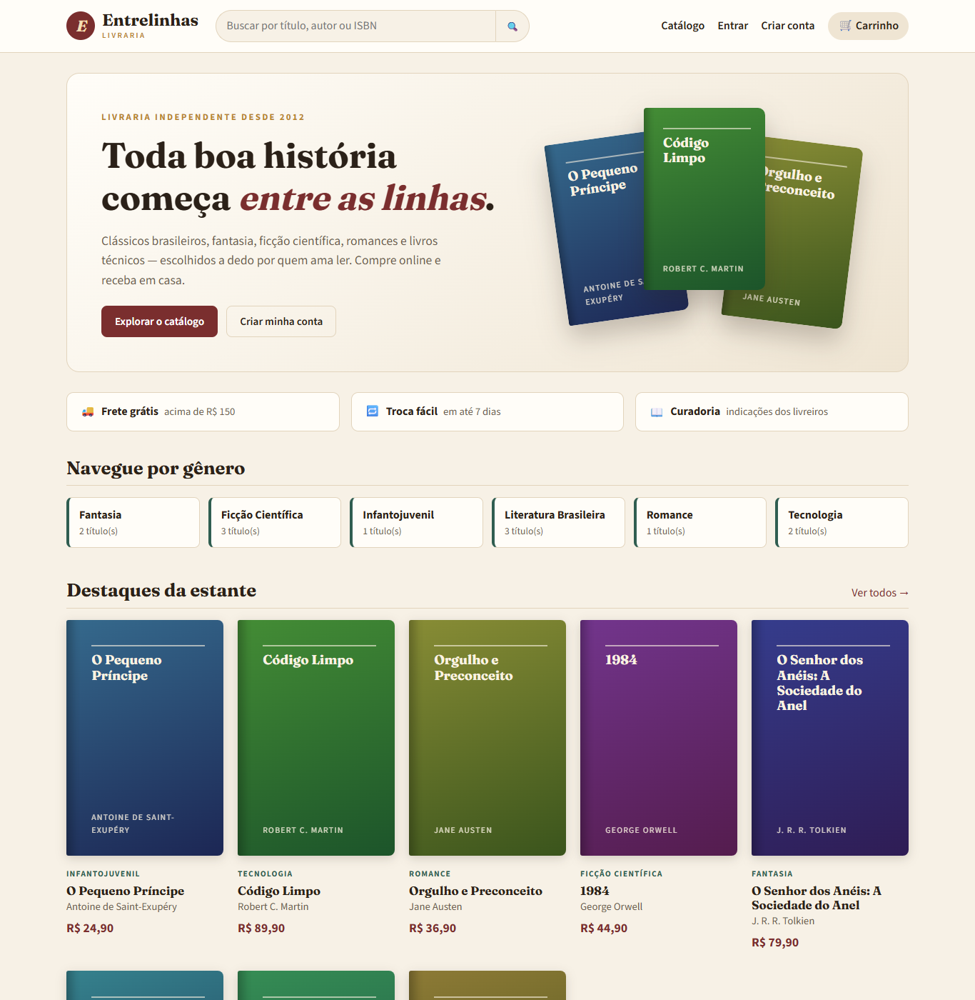

## Integrantes

- Rafael Franklin Gomes Cruz

## Tema da loja

**Livraria Entrelinhas**: livraria independente que vende literatura brasileira, fantasia, ficção científica, romance, livros técnicos e infantojuvenis.

## Descrição do sistema

O sistema tem duas áreas:

- **Loja (pública):** o cliente vê os destaques, navega pelo catálogo, busca livros, filtra por gênero, abre a página de detalhes, monta o carrinho, cria a conta, finaliza o pedido e acompanha os pedidos em "Minha conta".
- **Painel administrativo (restrito):** os funcionários fazem login e gerenciam livros, categorias, autores, clientes, pedidos e usuários. O painel também tem um dashboard e um relatório de vendas.

O planejamento completo (regras de negócio, UML, DER e SQL) está em [`docs/ETAPA1-planejamento.md`](docs/ETAPA1-planejamento.md).

## Tecnologias utilizadas

| Camada | Tecnologia |
|--------|------------|
| Back-end | PHP 8 (POO, `strict_types`, namespaces, autoload PSR-4 próprio) |
| Banco de dados | MySQL 8.4 com acesso via **PDO** (prepared statements) |
| Arquitetura | MVC: Models, Views e Controllers, com front controller e roteador |
| Front-end | HTML5, CSS3 (responsivo) e JavaScript puro |
| Ambiente | Docker / Docker Compose (MySQL, phpMyAdmin e, opcionalmente, PHP + Apache) |

## Estrutura de pastas

```
├── app/
│   ├── Controllers/          # Controllers da loja
│   │   └── Admin/            # Controllers do painel (um por CRUD)
│   ├── Core/                 # Núcleo: Database (PDO), Router, Controller, Model, Auth, Upload
│   ├── Models/               # Usuario, Cliente, Categoria, Autor, Livro, Pedido
│   ├── Views/                # Templates PHP (layouts, loja, conta, admin...)
│   ├── bootstrap.php         # Autoload, sessão e configuração
│   ├── helpers.php           # Funções auxiliares (e(), url(), moeda(), csrf...)
│   └── routes.php            # Todas as rotas
├── config/config.php         # Configuração (banco, upload)
├── database/livraria.sql     # Script completo do banco
├── docker/Dockerfile         # Imagem PHP 8.3 + Apache (opcional)
├── docs/                     # Planejamento (Etapa 1) e prints
├── public/                   # Única pasta exposta na web
│   ├── index.php             # Front controller
│   ├── assets/css, assets/js
│   └── uploads/capas/        # Capas enviadas
└── docker-compose.yml
```

### Fluxo MVC

```
Requisição → public/index.php → Router → Controller → Model (PDO/MySQL)
                                              ↓
                                     View (layout + template) → HTML
```

## Diagrama de classes

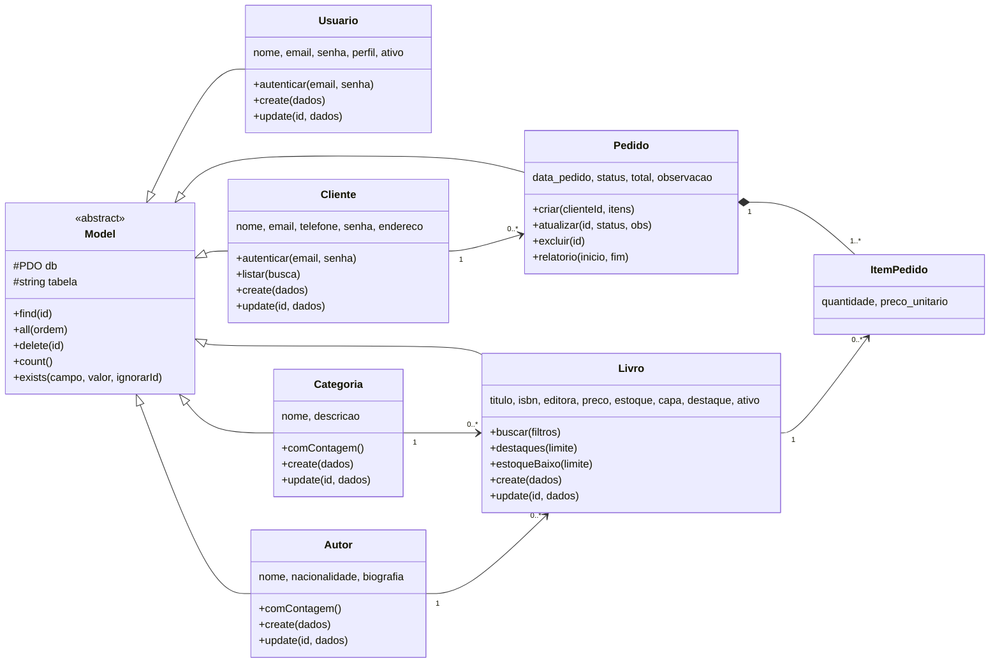

## Modelo do banco de dados

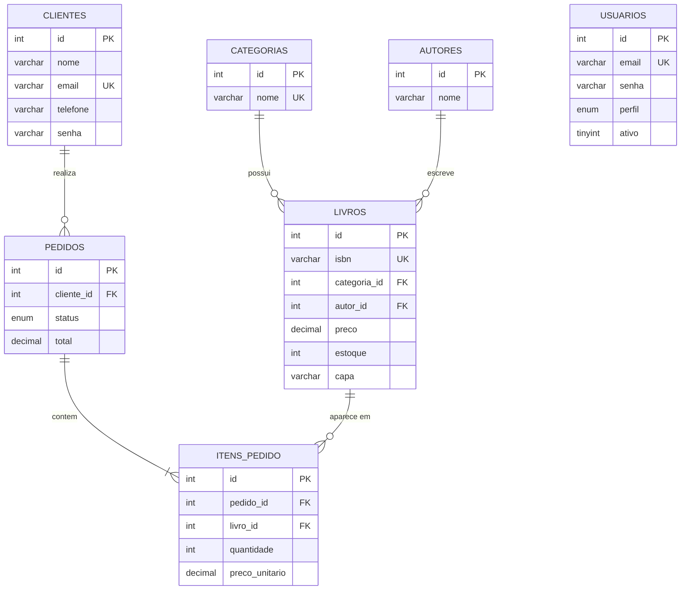

O script completo (criação do banco, tabelas, PK/FK e dados de teste) está em [`database/livraria.sql`](database/livraria.sql).

## Como instalar e executar

### Pré-requisitos

- [Docker Desktop](https://www.docker.com/products/docker-desktop/)
- **Opção A:** PHP 8.1+ instalado na máquina, com a extensão `pdo_mysql` habilitada
- **Opção B:** nada além do Docker

```bash
git clone <link-do-repositorio>
cd <pasta-do-projeto>
```

### Opção A: MySQL no Docker e PHP local (mais leve)

```bash
docker compose up -d db                              # sobe o MySQL na porta 3310 e importa o SQL
php -S localhost:8000 -t public public/index.php     # servidor embutido do PHP
```

Acesse **http://localhost:8000**

### Opção B: tudo no Docker

```bash
docker compose up -d --build
```

| Serviço | Endereço |
|---------|----------|
| Loja | http://localhost:8088 |
| phpMyAdmin | http://localhost:8089 |
| MySQL (host) | `127.0.0.1:3310`, usuário `livraria`, senha `livraria123` |

> O banco é criado e populado automaticamente na primeira vez que o container sobe.
> Para recriar o banco do zero: `docker compose down -v && docker compose up -d db`

As configurações de conexão ficam em `config/config.php` e podem ser sobrescritas pelas variáveis de ambiente `DB_HOST`, `DB_PORT`, `DB_NAME`, `DB_USER` e `DB_PASS`.

## Usuários de teste

| Área | E-mail | Senha | Perfil |
|------|--------|-------|--------|
| Admin (`/admin/login`) | `admin@entrelinhas.com` | `admin123` | Administrador (acesso total) |
| Admin (`/admin/login`) | `func@entrelinhas.com` | `func123` | Funcionário (sem gestão de usuários) |
| Loja (`/entrar`) | `ana@email.com` | `cliente123` | Cliente |
| Loja (`/entrar`) | `bruno@email.com` | `cliente123` | Cliente |

## Funcionalidades implementadas

### Requisitos obrigatórios

- ✅ Página inicial pública com apresentação da loja e livros vindos do banco
- ✅ Cadastro de clientes (nome, e-mail, telefone, endereço e senha)
- ✅ Login e logout de clientes e de funcionários (sessões separadas)
- ✅ Área administrativa protegida por login e controle de sessão (`session_regenerate_id` no login)
- ✅ Senhas com `password_hash()` / `password_verify()`
- ✅ **6 classes com CRUD completo:** Livro, Categoria, Autor, Cliente, Pedido e Usuário

### Funcionalidades extras

1. 🔎 **Busca de livros** por título, autor ou ISBN
2. 🏷️ **Filtro por categoria** e ordenação (título, preço, mais recentes)
3. 🖼️ **Upload de imagem** da capa, com validação do tipo real do arquivo e limite de 2 MB. Livros sem capa recebem uma capa gerada por CSS.
4. 🛒 **Carrinho de compras** na sessão, com finalização do pedido
5. 📦 **Controle de estoque**: baixa na compra, devolução ao cancelar ou excluir, bloqueio de venda acima do estoque e alerta de estoque baixo
6. 📊 **Dashboard administrativo** com faturamento, ticket médio, gráfico de vendas dos últimos 6 meses e últimos pedidos
7. 📈 **Relatório de vendas** por período (livros mais vendidos e vendas por categoria), pronto para impressão
8. 📖 **Página de detalhes do produto** com ficha técnica e livros relacionados
9. ✔️ **Validação de formulários com JavaScript** (mensagens em português, máscara de telefone, confirmação de senha, confirmação antes de excluir, pré-visualização da capa)
10. 👥 **Perfis de acesso**: somente o administrador gerencia usuários
11. 🔐 **Segurança**: proteção CSRF em todos os formulários POST, escape de saída contra XSS e prepared statements contra SQL Injection
12. 📱 **Layout responsivo**

## Prints das telas

| | |
|---|---|
| **Catálogo com filtro**<br>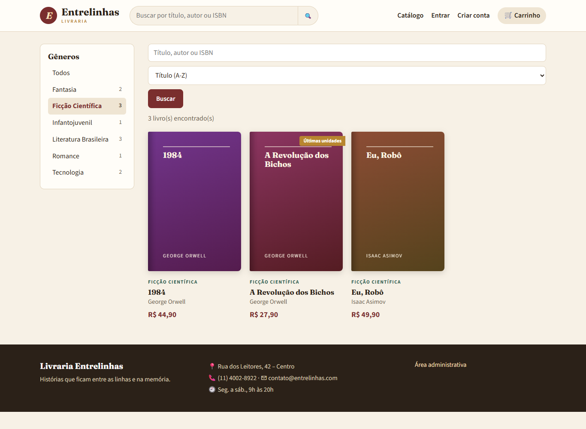 | **Detalhes do livro**<br>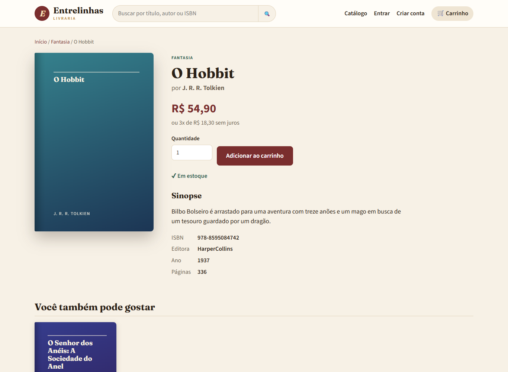 |
| **Cadastro de cliente**<br>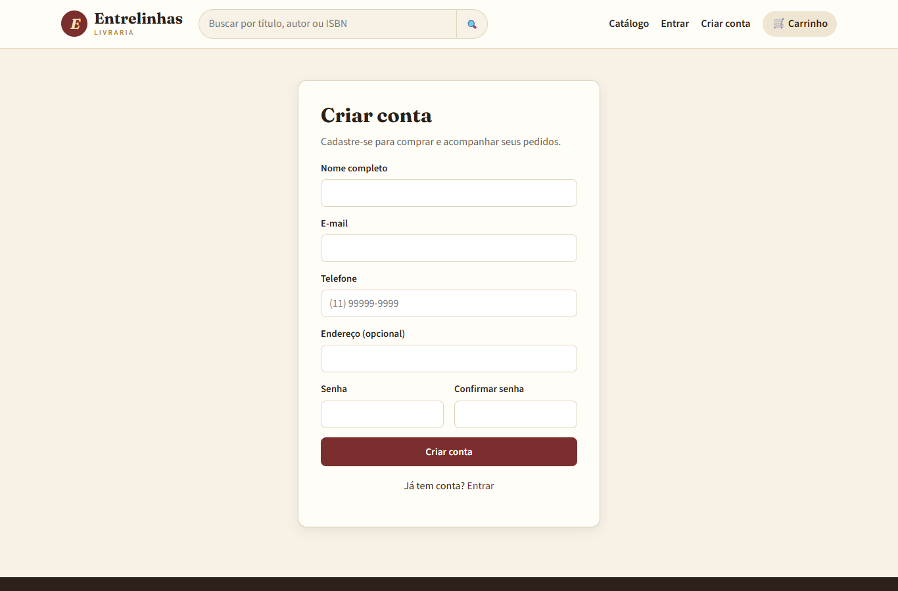 | **Carrinho**<br>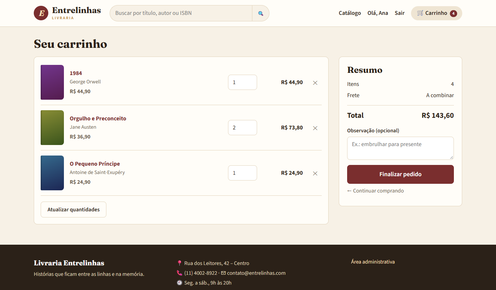 |
| **Minha conta**<br>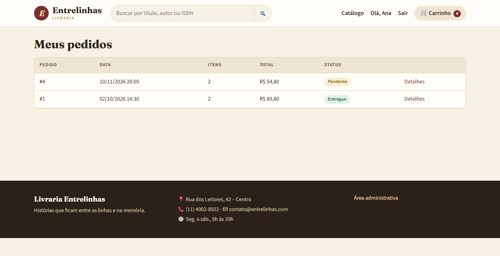 | **Login administrativo**<br>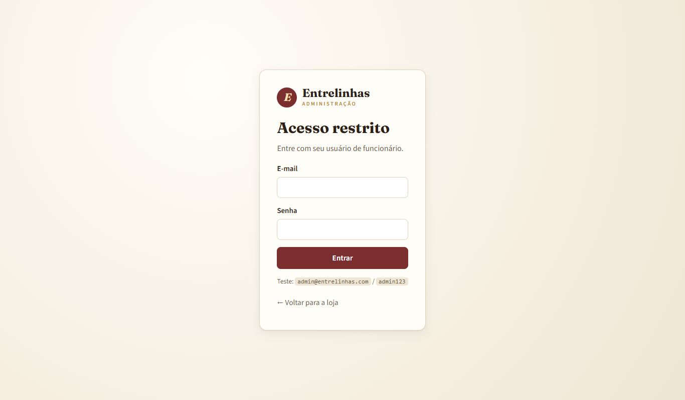 |
| **Dashboard**<br>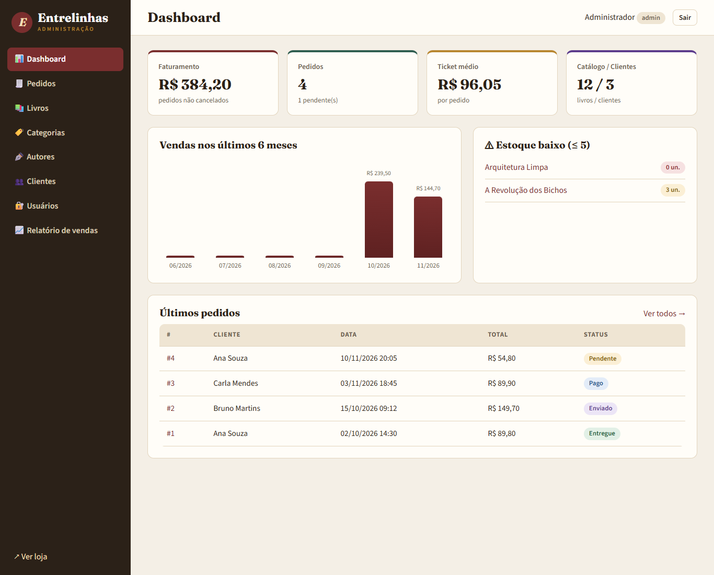 | **CRUD de livros**<br>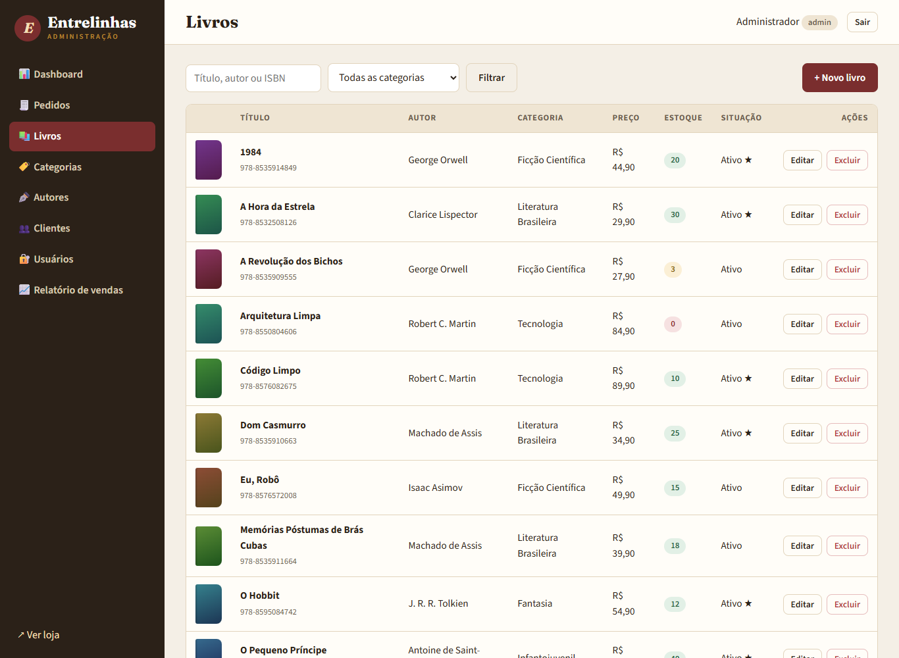 |
| **Edição de livro com upload**<br>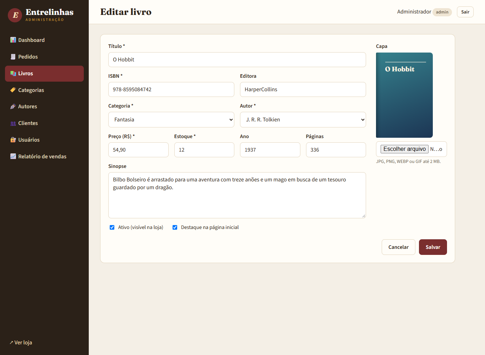 | **Pedidos**<br>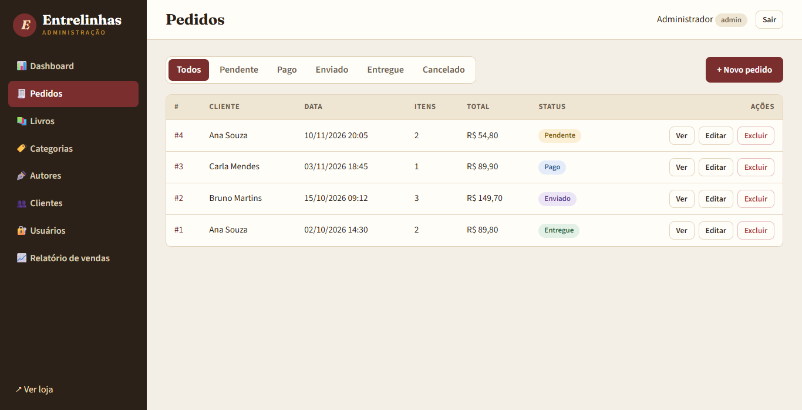 |
| **Novo pedido (itens dinâmicos)**<br>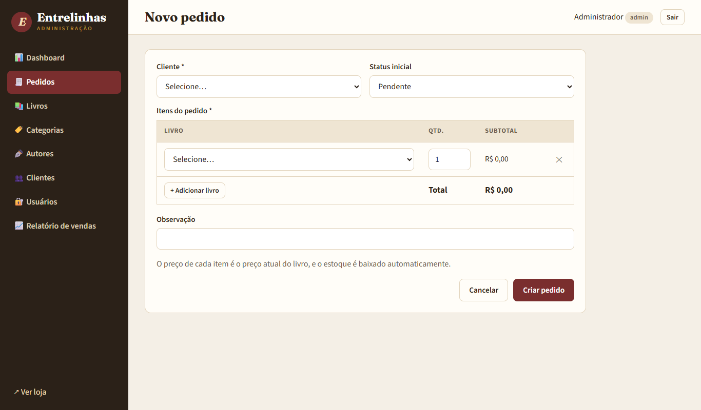 | **Relatório de vendas**<br>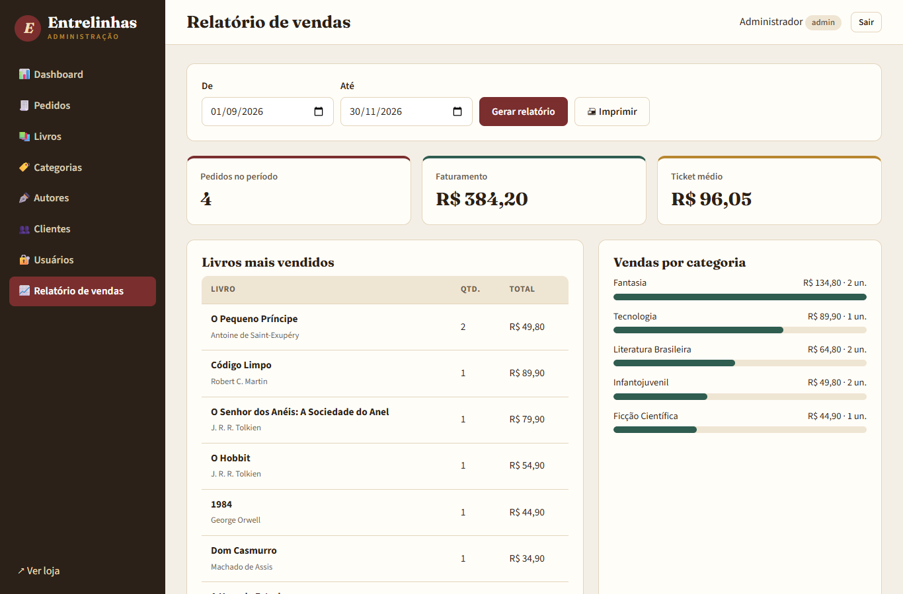 |
