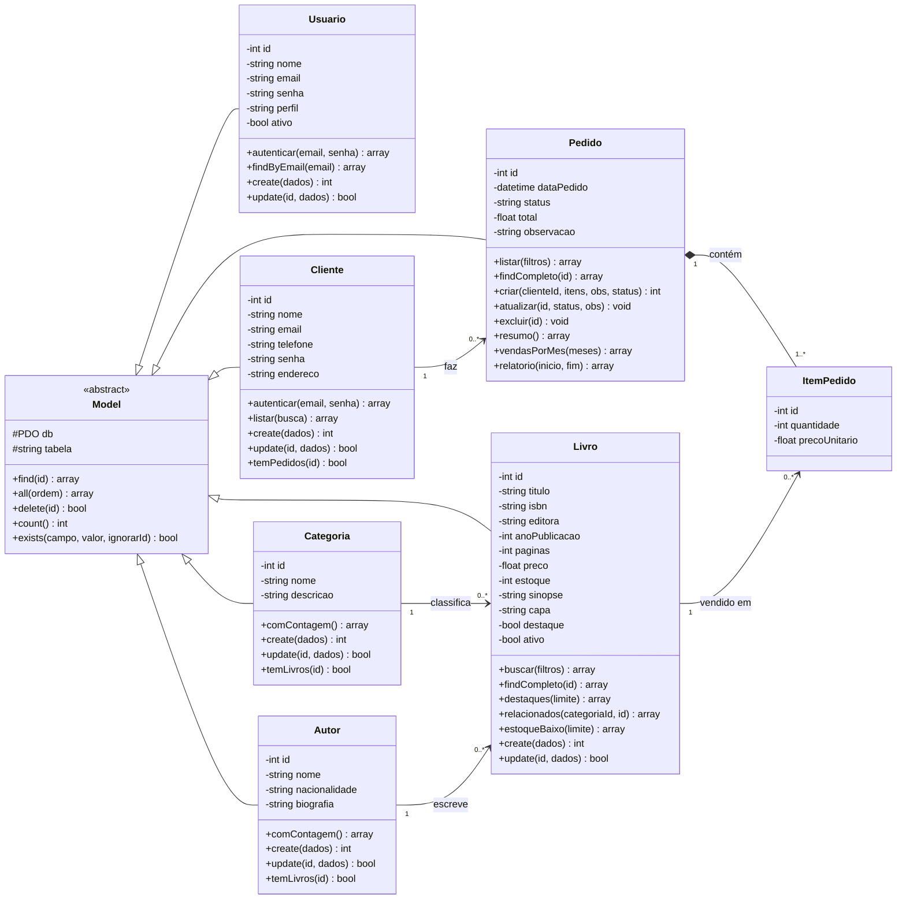
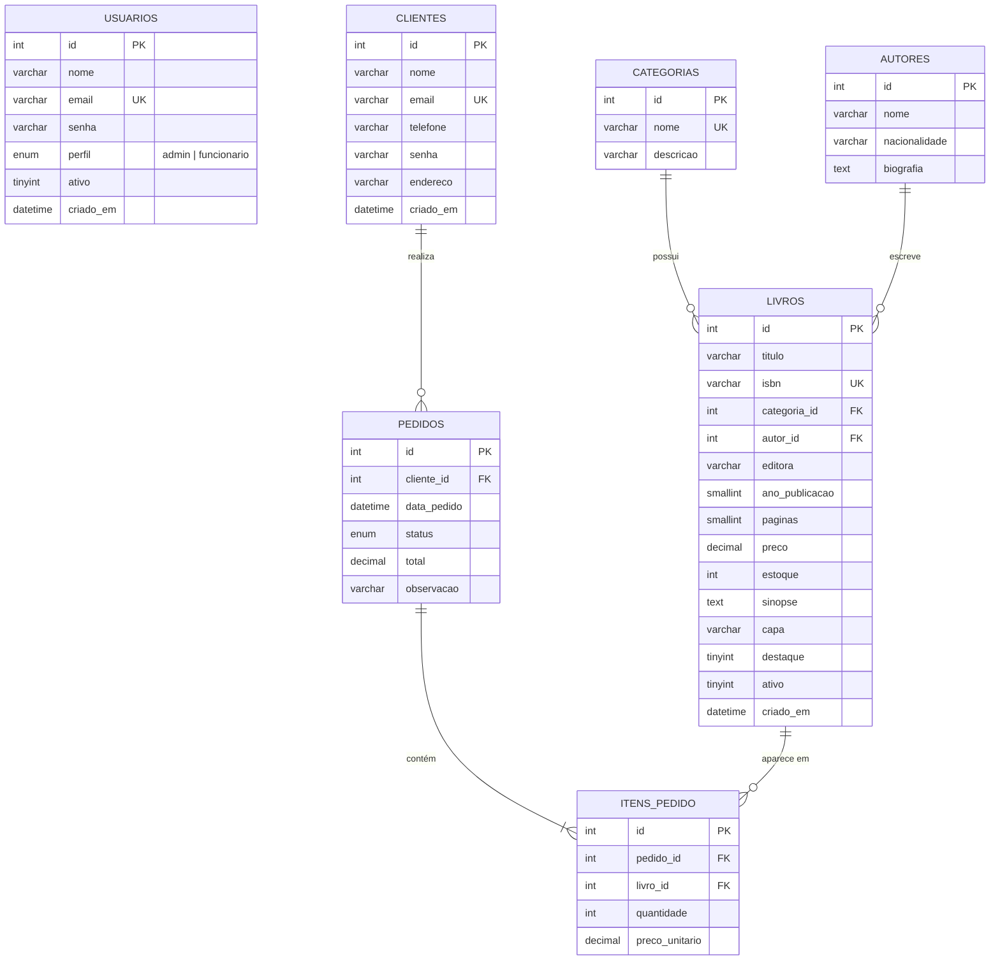

# Etapa 1 – Planejamento, modelagem e banco de dados

## Tema da loja

**Livraria Entrelinhas** — loja virtual de livros (literatura brasileira, fantasia, ficção científica, romance, tecnologia e infantojuvenil).

## Descrição do sistema

Sistema web em PHP 8 (MVC + PDO + MySQL) para uma livraria. Ele tem duas áreas:

- **Área pública (clientes):** página inicial com destaques e gêneros, catálogo com busca e filtro por categoria, página de detalhes do livro, carrinho de compras, cadastro e login de clientes, finalização do pedido e histórico de pedidos ("Minha conta").
- **Área administrativa (funcionários):** login restrito, dashboard com indicadores, CRUD de livros (com upload de capa), categorias, autores, clientes, pedidos e usuários, e relatório de vendas por período.

## Regras de negócio

| # | Regra |
|---|-------|
| RN01 | Apenas usuários (funcionários) autenticados acessam a área administrativa. |
| RN02 | Somente usuários com perfil **admin** podem gerenciar outros usuários. |
| RN03 | Um usuário não pode excluir, desativar ou rebaixar a própria conta. |
| RN04 | Usuários inativos não conseguem fazer login. |
| RN05 | Senhas de usuários e clientes são armazenadas com `password_hash()` e conferidas com `password_verify()`. |
| RN06 | O e-mail é único para clientes e para usuários. O ISBN do livro e o nome da categoria também são únicos. |
| RN07 | O cliente pode montar o carrinho sem login, mas precisa estar logado para finalizar o pedido. |
| RN08 | O cliente só pode ver os próprios pedidos. |
| RN09 | O preço do livro deve ser maior que zero e o estoque não pode ser negativo. |
| RN10 | Não é possível comprar uma quantidade maior que o estoque disponível. Livros esgotados aparecem como "Esgotado" e não podem ser adicionados ao carrinho. |
| RN11 | Ao criar um pedido, o estoque de cada livro é baixado. O preço unitário é gravado no item (o histórico não muda se o preço do livro mudar depois). |
| RN12 | Ao **cancelar** um pedido, os livros voltam ao estoque. Ao reativar um pedido cancelado, o estoque é baixado de novo (se houver saldo). |
| RN13 | Ao excluir um pedido que não estava cancelado, os livros voltam ao estoque. |
| RN14 | Não é possível excluir categoria ou autor que tenha livros vinculados. |
| RN15 | Não é possível excluir livro que já aparece em pedidos (para manter o histórico). Nesse caso o livro deve ser **desativado**. |
| RN16 | Não é possível excluir cliente que possui pedidos. |
| RN17 | Livros inativos não aparecem na loja. |
| RN18 | Status possíveis do pedido: pendente → pago → enviado → entregue, ou cancelado. |
| RN19 | O faturamento e os relatórios desconsideram pedidos cancelados. |

## Diagrama de classes (UML)

## Modelo do banco de dados (DER)

`usuarios` não tem relação com as demais tabelas: ela guarda apenas quem acessa o painel.

## Script SQL

O script completo está em [`database/livraria.sql`](../database/livraria.sql). Ele faz:

- criação do banco `livraria` (utf8mb4);
- criação das 7 tabelas com chaves primárias (`AUTO_INCREMENT`);
- chaves estrangeiras com `ON DELETE RESTRICT` (categoria, autor, cliente, livro) e `ON DELETE CASCADE` (itens do pedido);
- restrições `UNIQUE` (e-mails, ISBN, nome da categoria) e `CHECK` (preço > 0, quantidade > 0);
- dados iniciais: 2 usuários, 3 clientes, 6 categorias, 8 autores, 12 livros e 4 pedidos com itens.
